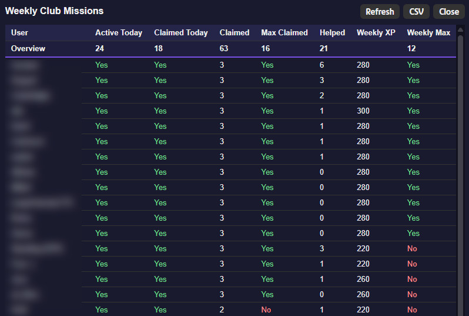

# GeoGuessr Weekly Club Mission Overview

A userscript that shows the progress of the weekly club missions **per member** in a sortable table on the GeoGuessr club page.
Works only for the users **own** club!

## Features

- Overview of every club member's weekly mission activity
- Sortable columns (click a column header, click again to reverse)
- Summary row with totals at the top of the table
- CSV export
- Refresh button to reload the data without reloading the page

## Installation

1. Install a userscript manager, for example [Violentmonkey](https://violentmonkey.github.io/) or [Tampermonkey](https://www.tampermonkey.net/).
2. Install the script from one of these sources:
    - [Greasy Fork](https://greasyfork.org/de/scripts/601242-geoguessr-weekly-club-mission-overview)
    - [Raw file on GitHub](https://github.com/Gorakel/geoguessr-club-missions/raw/refs/heads/main/club-missions.user.js)
3. Confirm the installation in the dialog of your userscript manager.

Use only one source per browser. Installing the same script from both can lead to conflicting updates.

## Usage

1. Log in to GeoGuessr and open your club page at `https://www.geoguessr.com/clubs/my`.
2. Click the purple **Club Missions** button in the bottom left corner.
3. Use **Refresh** to reload, **CSV** to download the table, and **Close** (or a click outside the window) to leave.

If the panel reports that the club ID was not found, reload the page with F5 and try again. You need to be logged in and a member of the club.

## Columns

| Column        | Meaning                                                                               |
| ------------- | ------------------------------------------------------------------------------------- |
| User          | Nickname of the member                                                                |
| Active Today  | Member was active since the last daily mission claim reset                            |
| Claimed Today | Member claimed a mission tile since the last daily mission claim reset                |
| Claimed       | Number of tiles the member has claimed this week                                      |
| Max Claimed   | Member has claimed at least as many tiles as expected for the current day of the week |
| Helped        | Number of tiles on which the member is listed as a helper (all boards of the week)    |
| Weekly XP     | XP the member earned this week, taken from members page                               |
| Weekly Max    | Member reached the current maximum weekly XP                                          |

The **Overview** row at the top shows totals: counts of "Yes" for the yes/no columns and sums for the number columns.

### Daily reset and Weekly Max

- The daily reset time to claim a mission is read from the `nextDayAt` field of the club mission board response (currently at 11:00 UTC).
- The maximum weekly XP is 280. From 00:00 UTC until the next daily reset, the threshold is lowered by 20 XP (260), because the next day's mission has not been unlocked yet while e.g. daily challenge can already be done.

## How it works

The script reads two GeoGuessr endpoints using your existing browser session. No data is sent anywhere else, and nothing is stored.

- `/api/v4/clubs/<clubId>/members`
- `/api/v4/missions/club/board`

## Notes

- The script depends on undocumented GeoGuessr API responses. If GeoGuessr changes them, the script may stop working until it is updated.
- This is a fan project and is not affiliated with GeoGuessr.
- Code was converted to js via Claude Sonnet 5.5.
- Readme was created with help of Claude Sonnet 5.5.

## License

[MIT](LICENSE)
